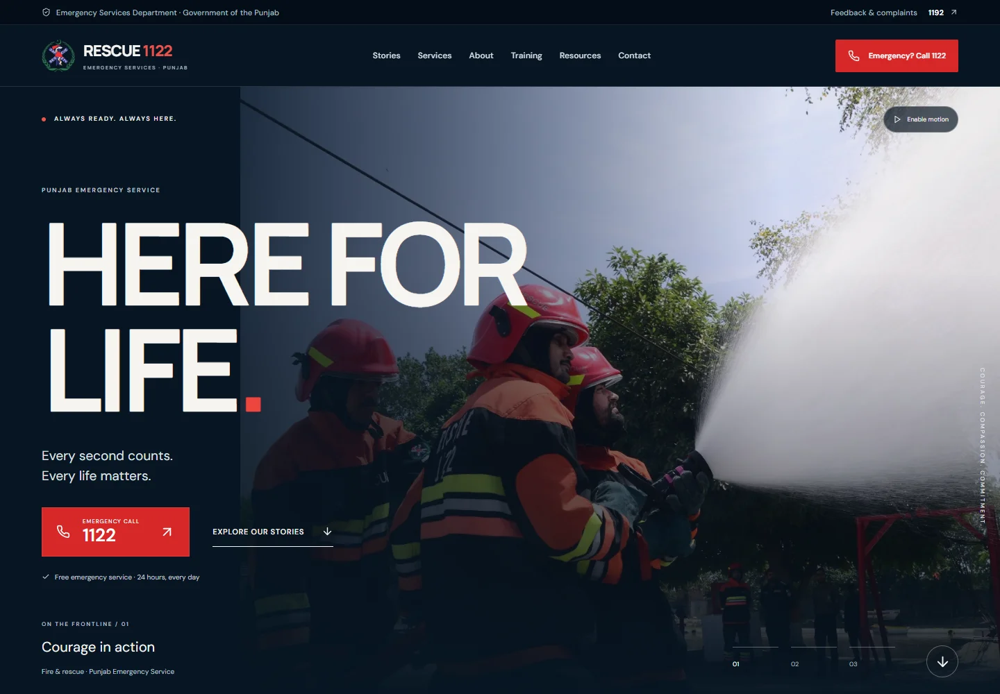

# Rescue 1122 — Website Redesign

[](https://github.com/Ehteshamali-889/rescue1122-website/actions/workflows/ci.yml)

A responsive React portfolio project exploring a clearer, more engaging digital experience for Punjab's emergency services. The design combines documentary photography, service discovery, and community training resources with keyboard-accessible interactions.

**[Live demo](https://rescue1122.netlify.app/)** · **[Official Rescue 1122 website](https://www.rescue.gov.pk/)**

> Independent UI redesign concept. This project has no official affiliation with Rescue 1122 or the Government of Punjab. It has no emergency dispatch, booking, or backend integration. Telephone and training links point to external services.



[View the phone layout](docs/images/mobile.webp)

## Design goals

- Make emergency and service information easy to identify through a clear hierarchy and visible call links.
- Bring the people behind the service into focus through real photography and short, interactive stories.
- Keep service details and training resources easy to explore across desktop, tablet, and phone layouts.
- Give visitors control over motion and support keyboard navigation throughout the experience.

These are design intentions, not measured usability improvements. This concept has not been validated through user research or an official accessibility audit.

## Features

- Three-scene hero with manual selection, pause controls, and automatic cycling that stops when offscreen or the browser tab is hidden.
- Photo archive with gallery/list views, pointer interaction, and navigable story dialogs.
- Frontline contact sheet with a desktop composition and native horizontal scrolling on smaller screens.
- Ten-service explorer with responsive tab orientation, arrow-key navigation, Home/End shortcuts, and service details.
- Native modal dialogs with Escape to close, Tab/Shift+Tab containment, and focus restoration without scroll jumps.
- Expandable FAQs, official CPR and volunteer programme links, and photography credits.
- Responsive WebP images, reserved image dimensions, lazy loading, and priority loading for the opening photograph.
- Reduced-motion support through the operating system preference and an explicit website motion switch.

## Stack

| Layer          | Technology                          |
| -------------- | ----------------------------------- |
| Interface      | React 19, semantic HTML, CSS        |
| Icons          | Lucide React                        |
| Build          | Vite 6                              |
| Motion         | CSS and the Web Animations API      |
| Quality        | ESLint, React Hooks rules, Prettier |
| Browser checks | Playwright and axe-core             |
| Hosting        | Netlify                             |

## Run locally

Use **Node.js 24 LTS** and npm. The supported minimum is Node.js 22.13; CI and Netlify use Node.js 24.

```sh
git clone https://github.com/Ehteshamali-889/rescue1122-website.git
cd rescue1122-website
npm ci
npm run dev
```

Open the local address printed by Vite. No environment variables, API keys, or external backend are required. Google Fonts needs an internet connection; local sans-serif fallbacks keep the page usable if it is unavailable.

```sh
npm run build
npm run preview
```

The production output is written to `dist/`. Netlify's build command, output directory, and Node version are defined in [`netlify.toml`](netlify.toml).

## Quality checks

Install the test browser once:

```sh
npx playwright install chromium
```

Then run:

```sh
npm run check
```

This runs linting with zero warnings allowed, a formatting check, a production build, and the browser suite. Individual commands are also available:

| Command                | Purpose                                       |
| ---------------------- | --------------------------------------------- |
| `npm run lint`         | Check JavaScript, JSX, and React Hooks usage  |
| `npm run format:check` | Verify consistent formatting                  |
| `npm run format`       | Apply formatting                              |
| `npm run build`        | Create a production build                     |
| `npm test`             | Test an existing production build in Chromium |

The browser suite checks image loading and section links; service-tab keyboard navigation; dialog navigation, focus containment, and focus restoration; the frontline-to-service handoff; mobile menu dismissal; reduced motion; FAQ behavior; and page overflow at 320, 390, 768, 1024, 1440, and 1920 pixels. axe-core scans the page and a story dialog at desktop and phone sizes. Automated checks do not replace manual screen-reader testing or establish full WCAG conformance.

GitHub Actions runs the same checks on pushes to `main` and pull requests. Failed browser runs retain local traces in `test-results/` for inspection with `npx playwright show-trace <trace.zip>`.

The `minimatch` override keeps the lint toolchain on the patched major version for [GHSA-g3hv-75wg-m249](https://github.com/advisories/GHSA-g3hv-75wg-m249). It can be removed when the upstream lint dependencies adopt that version.

## Project structure

```text
src/
  main.jsx                    # Entry point and global styles
  App.jsx                     # Page sections and selected-service state
  components/                 # Navigation, footer, credits, service dialog
  context/MotionContext.jsx   # Shared motion preference
  hooks/                      # Dialog lifecycle, media query, visibility
  content.jsx                 # Service content and responsive Photo component
  documentary.jsx             # Hero, archive, frontline chapters, service explorer
  FrontlineContactSheet.jsx   # Frontline composition and photograph dialog
  image-manifest.json         # Source URLs, dimensions, responsive variants
  *.css                       # Base, documentary, and frontline styles
public/
  images/                     # Local photographs, variants, and emblem
  social-preview.jpg          # Social sharing preview
tests/website.spec.js         # Interaction, responsive, and accessibility checks
```

## Assets and attribution

Photograph source pages, original dimensions, and responsive variants are recorded in [`src/image-manifest.json`](src/image-manifest.json). Visitors can also open the **Photography & sources** section in the footer. Photography includes material credited to Punjab Emergency Service and Dawn; the Rescue 1122 emblem and branding belong to their respective owner. Third-party assets are not presented as original work or relicensed by this project.

Fonts: [DM Sans](https://fonts.google.com/specimen/DM+Sans) and [Manrope](https://fonts.google.com/specimen/Manrope), served through Google Fonts. Icons: [Lucide](https://lucide.dev/).

## Scope and tradeoffs

This is a single-page frontend concept. It does not send emergency requests, collect personal information, or provide a live service status. Animations are progressive enhancements; the information remains available with motion disabled. The layered CSS retains the base page styling alongside the documentary treatment, while the frontline layout has its own stylesheet. Broader screen-reader, cross-browser, and usability testing would be needed before production adoption.
